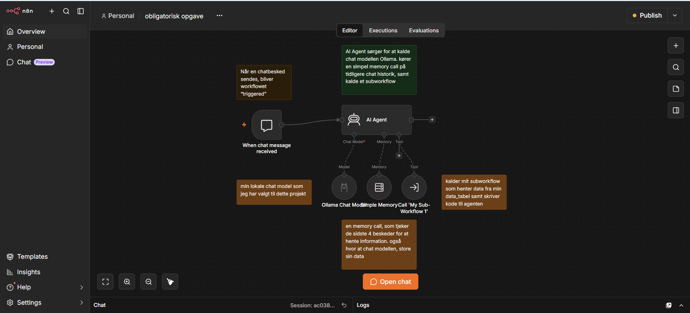
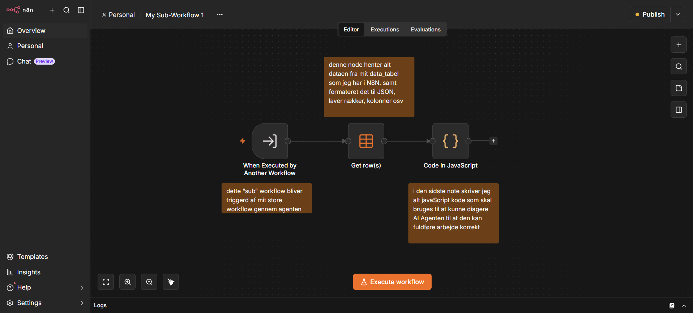
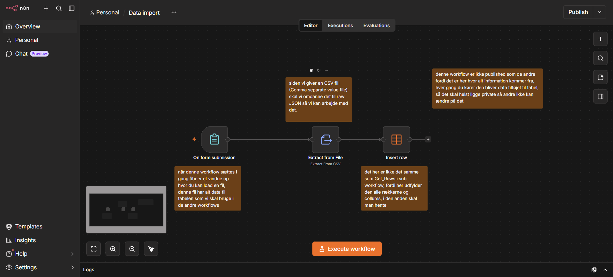
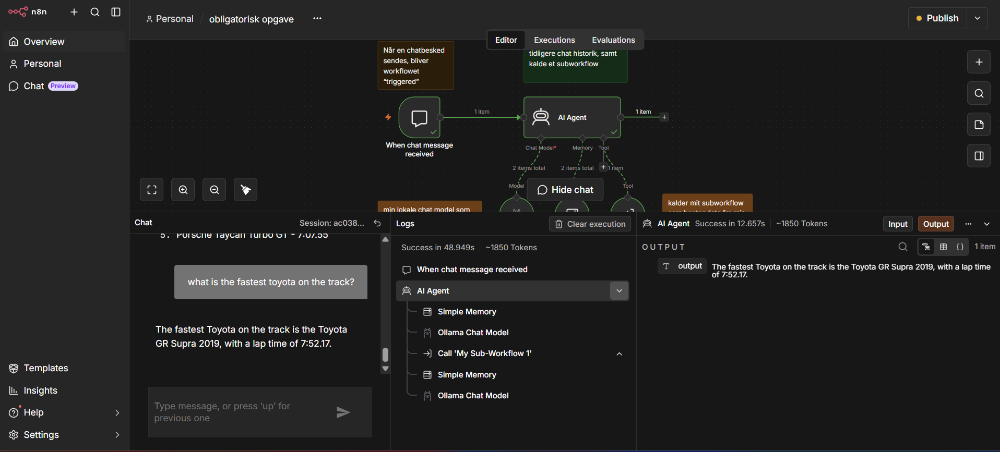

# AI-agent
obligatorisk opgave til AI agenter og automatisering

Hej Lasse! dette er mit projekt som jeg har arbejdet på de seneste 2 uger. projektet virker sådan her:

dette er et billede af mit hoved workflow i N8N. workflow har en trigger "When chat message recieved" dette er vigtigt fordi at vi arbejder med en Ai-chatbot. derfor starter workflow når at en bruger har sendt en besked til chatbot.

det der sker er følgende:
1. bruger skriver i teksfeltet.
2. AI Agent bliver tilkaldt
3. ai agent laver et simple Memory kald, "loadMemoryVariables", som tjekker historien af dine beskeder med chatbotten
4. Ai agenten derefter kalder selve chat- modellen, som i dette projekt er Ollama (self hosted gennem docker desktop)
5. derefter er der blevet tilføjet et tool til Ai-agenten som hedder call "My Sub-workflow 1". dette er en separat worflow i N8N som ser sådan her ud:
   

6. her kan vi se at trigger for at starte dette workflow er " When executed by another workflow". dette betyder at workflow kun starter når at den er blevet kaldt udefra, nemlig min Main workflow.
7. her kalder den først på "Get rows" som henter alle rows fra min Data-tabel 'Nurburgring lap times', det ser sådan her ud:
   

8. den data den henter kan findes ikke i et workflow, men en data tabel, som har alt i alt 18 kolloner med information, såsom lap time, model navn, krøer som fulførte tiden, året testet skete, distance på banen osv.
9. når alt dataen er hentet kører subworkflowet videre til et 'Code in Javascript node', her er alt koden som skal bruges til at min ollama chatbot kan samle den korekte information ind. såsom at sammenligne brugeresn tekst men data fra tabelen, og tag de korrekte informationer fra den, som den kan sende tilbage som svar til brugeren.
10. lige pt, har jeg fået Claude til at udføre mange af de funktioner som bliver beskrevet i JavaScript-koden, da det er for det meste begreber jeg endnu ikke har lært endnu, et udrav af denne kode ser sådan her ud:

    "const p = $('When Executed by Another Workflow').first().json;
const rows = $input.all().map(i => i.json);

const norm = v => (v ?? '').toString().trim().toLowerCase();
const EMPTY = ['', 'null', 'none', 'any', 'all', 'n/a', 'undefined'];
const terms = v => norm(v).split(/[,;|]/).map(s => s.trim()).filter(s => s && !EMPTY.includes(s));

const GENERIC = ['production','production car','production cars','car','cars','vehicle',
  'vehicles','fastest','road legal','street legal','street-legal','nurburgring','nürburgring'];
const alias = { ev:'electric', evs:'electric', electrics:'electric', 'electric car':'electric',
  'electric cars':'electric', 'sports car':'sportscar', 'sports cars':'sportscar',
  sportscars:'sportscar', 'super car':'supercar', 'super cars':'supercar', supercars:'supercar',
  hypercars:'hypercar', sedans:'sedan', suvs:'suv', hybrids:'hybrid', 'track cars':'track car',
  prototypes:'prototype' };

let typeTerms = [...terms(p.category), ...terms(p.powertrain), ...terms(p.list)]
  .map(t => alias[t] ?? t).filter(t => !GENERIC.includes(t));
const wantProto = typeTerms.includes('prototype');
typeTerms = typeTerms.filter(t => t !== 'prototype');"

11. når alt dette er kørt, og subworkflower er færdig. så vender den tilbage til vores hoved workflow, som sender alt den data den har fundet tilbage til ollama chat modellen, som så givet et svar tilbage til brugeren. alt efter dit spørgsmål, kan et svar tage mellem 1-3 minutter at komme tilbage, og dette er blandt andet fordi at modellen ikke er særlig stor, da jeg kører den lokalt, og har denied den permission i agent settings, at tænke selvstænding. det vil sige at alle spørgsmål som ikke handler om den tyske racerbane, nurburgring nordschleife, vil blive mødt med "no information available on the subject at this time".
det kan vi se med det her billede som viser stien der er blevet taget:

